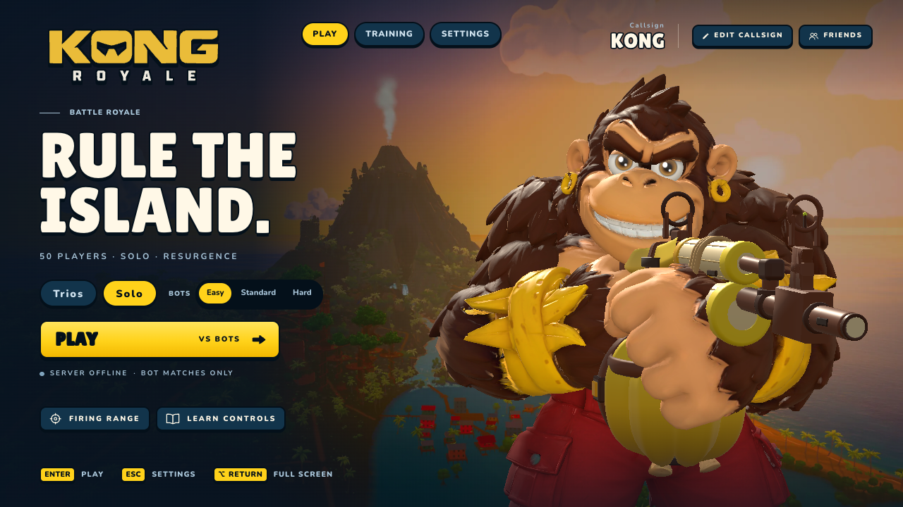
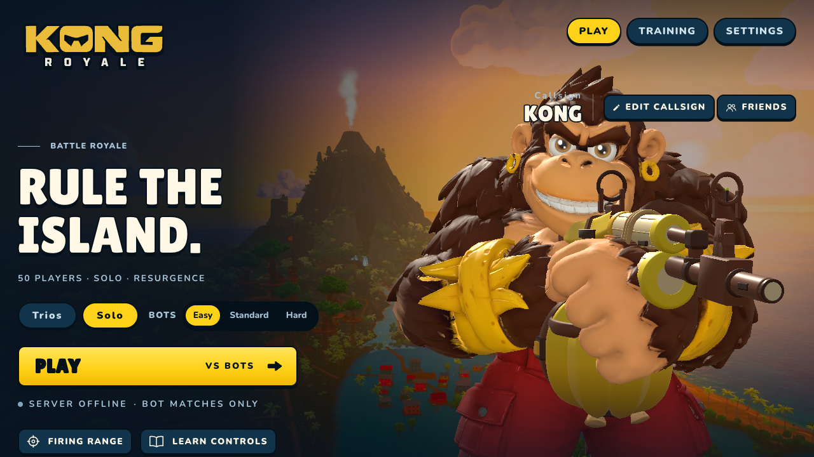
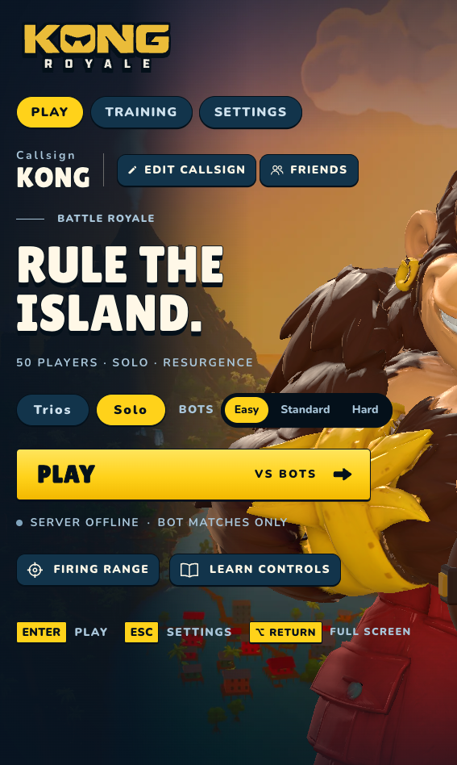

# Lobby sizing design draft

This draft makes the lobby controls readable independently of the decorative canvas scale. It is a starting point for design iteration in the fork, pending Kyle's visual review.

- Navigation and mode controls use a 16 CSS px minimum; secondary actions and difficulty labels use 14 px.
- At widths up to 1600 px or heights up to 800 px, the lobby uses document flow with vertical scrolling. At widths up to 800 px, the header groups stack.
- The existing artwork, palette, button treatment and game behavior are retained. The composition and breakpoints remain open for revision.

These sizes are product readability targets, not universal WCAG requirements or a claim of accessibility conformance.

## Local captures

Both captures use Chrome with hardware ANGLE/Metal on a locally served game, seed 42, after the loading screen disappears. The animated scene may differ between captures. Before uses the existing lobby stylesheet (the prior audit checkout also has the separate Learn controls label change).

| Viewport | Before | Draft |
| --- | --- | --- |
| 1280 × 720 |  |  |
| 567 × 948 |  |  |

## Validation

- Production build passed.
- All 11 repository check groups passed.
- Production-constructor layout checks at 1440×900, 1366×768, 1280×720 and 567×948: navigation 16 px, difficulty labels 14 px, no root horizontal overflow, vertical overflow set to auto.
- Local game reached `window.__kr.ready === true`, then entered an offline bot match; `window.__kr.errors` was empty at both checkpoints.
- Captured the narrow callsign editor and previously inspected Training in the constructor fixture.

## Remaining before readiness

Review the composition and spacing, especially the extra header row and scrolling on short laptops. Validate final changes at desktop widths, both playtest and developer title variants, browser zoom/text resizing, keyboard/controller focus, and private-room states. Reconcile with the separate zoom and difficulty-target tickets; this draft does not close them.

Tracking: [KYL-111](https://linear.app/kylenakamura/issue/KYL-111/make-lobby-text-and-actions-readable-at-laptop-and-narrow-sizes) and [fork issue #2](https://github.com/knakamura13/kong-royale/issues/2).
